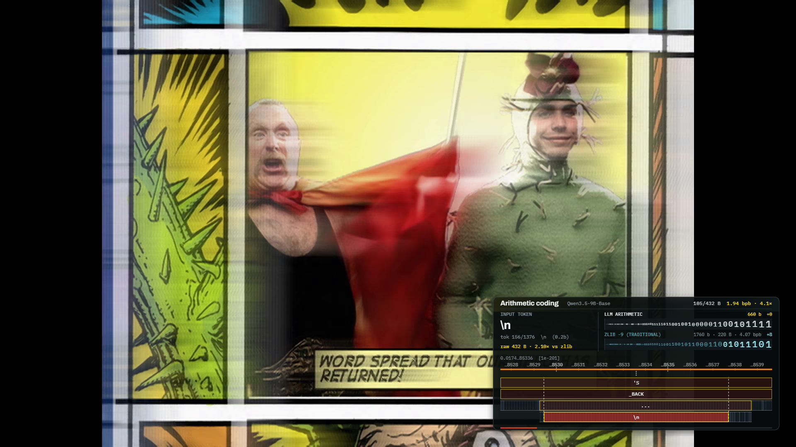
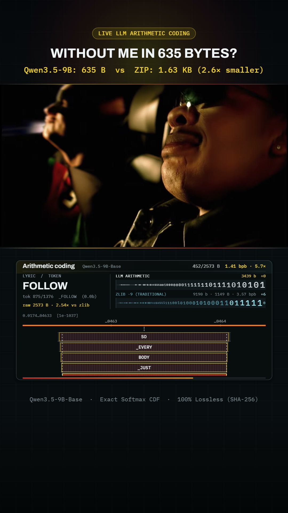
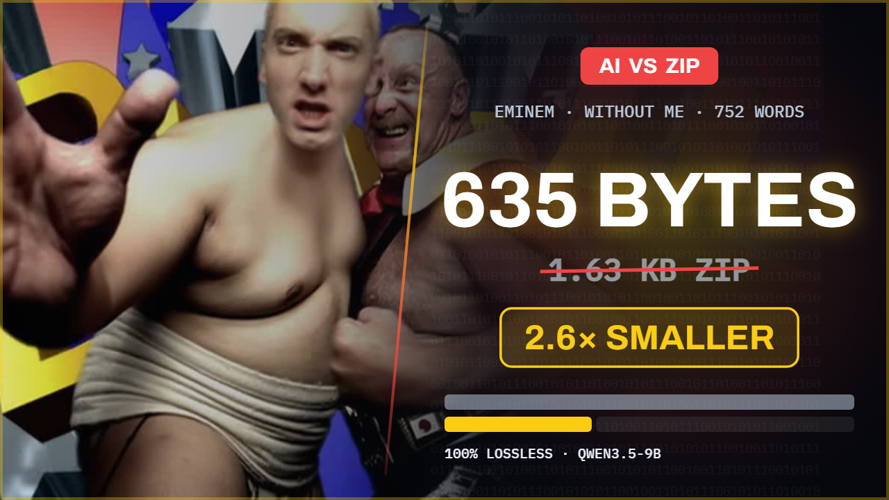

# LLM Video Encoder

[](https://www.python.org/downloads/)
[](https://nodejs.org/)
[](LICENSE)

End-to-end pipeline for rendering live, word-synced **100% lossless LLM Arithmetic Coding vs. `zlib -9` (ZIP)** visualizations onto **any video with speech, narration, or song lyrics** — outputting full `1080p50/60` horizontal videos, true-vertical `1080×1920` Shorts/Reels, and high-CTR `1280×720` thumbnails.

Inspired by Claude Shannon's information theory and 3Blue1Brown's *"Compression is Intelligence"*. Powered by the arithmetic coding engine from [llm-compressor](https://github.com/TryCatchIgnoreDev/llm-compressor).

---

## Visual Previews

### Full 1080p60 Horizontal Video Overlay
*Live `[0, 1)` arithmetic coding sub-interval zoom (down to `1e-1000+`), scrolling LLM bitstream vs. `zlib -9` bitstream, and real-time bits-per-byte compression ratio synced word-by-word to the video.*



### True-Vertical `1080×1920` Short & `1280×720` Thumbnail

| Vertical Short (`1080×1920` @ 60fps) | Custom Thumbnail (`1280×720`) |
| :---: | :---: |
|  |  |

---

## Key Features

- **Works on Any Video**: Podcasts, speeches, lectures, essays, interviews, or music videos — pass any **YouTube URL** or **local `.mp4`/`.mkv`/`.mov` file**.
- **Automatic Word-Level Sync (`faster-whisper` + DP Alignment)**:
  1. Uses official manual YouTube subtitles if available,
  2. Optional synced LRC lookup (`--lrclib`) for songs,
  3. Custom plain-text transcript (`--transcript file.txt`), or
  4. **Fully automatic Whisper transcription** when no subtitle or transcript file is provided.
- **100% Verified Lossless LLM Compression**:
  - Uses any local `.gguf` language model via `llama-cpp-python` (exact full-vocabulary Softmax CDF + 62-bit integer Arithmetic Coding).
  - Automatically decompresses the `.llmc` binary and verifies **exact SHA-256 byte-for-byte match** before rendering.
- **Cross-Platform Multi-Worker Renderer**:
  - Parallel headless Chromium (`playwright-core`) Canvas2D RGBA streaming piped directly into `ffmpeg`.
  - Automatically uses NVIDIA `h264_nvenc` when available and falls back seamlessly to CPU `libx264` on macOS, Linux, or AMD/CPU-only machines.
  - Bundles open-source SIL OFL fonts (`Archivo` & `IBM Plex Mono`) — zero external font setup required.

---

## Architecture

```text
llm-video-encoder/
├── studio.py                   # Unified CLI: init | align | compress | stills | render | shorts | thumb | all
├── core/
│   ├── align_words.py          # faster-whisper (CUDA/CPU auto) + DP word-level alignment & auto-transcription
│   ├── compress_text.py        # Lossless GGUF Softmax CDF + 62-bit Arithmetic Coding + SHA-256 verify + zoom trace
│   ├── arithmetic_coder.py     # 62-bit integer arithmetic encoder/decoder & exact CDF quantization
│   └── compressor.py           # llama-cpp-python KV-cache compression engine
├── renderer/
│   ├── overlay.html            # Theme/palette-driven Canvas2D live Arithmetic Coding HUD
│   ├── render.mjs              # Multi-worker Chromium RGBA streaming + ffmpeg compositor (1080p50/60)
│   ├── render_shorts.mjs       # True-vertical 1080×1920 @ 60fps Shorts/Reels renderer
│   ├── render_thumb.mjs        # High-CTR 1280×720 "AI VS ZIP" thumbnail generator
│   └── fonts/                  # Bundled SIL OFL fonts (Archivo + IBM Plex Mono)
└── jobs/<slug>/                # Isolated per-video workspace (gitignored)
    ├── job.json                # FPS, theme, overlay corner/scale/margins, custom palette
    ├── work/                   # source.mp4, audio16k.wav, subtitles/transcript, preview_frames/
    ├── data/                   # transcript.json, encoded.llmc, compression.json
    └── out/                    # Final MP4, vertical Short MP4, QA stills/, thumbnail PNG
```

---

## Installation

### Prerequisites
- **Python 3.10+**
- **Node.js 20+**
- **`ffmpeg` & `ffprobe`** on your `PATH`
- A local **`.gguf` language model** (e.g., Qwen, Llama, Gemma, GPT-2, Mistral)

### Setup

```bash
git clone https://github.com/TryCatchIgnoreDev/llm-video-encoder.git
cd llm-video-encoder

# 1. Python dependencies
pip install -r requirements.txt

# 2. Node renderer dependencies + headless Chromium
npm install
npx playwright-core install chromium
```

> **Tip:** You can set `LLM_MODEL_PATH=/path/to/your/model.gguf` as an environment variable so you don't have to pass `--model` on every command. If you keep `faster-whisper` in a separate Python virtual environment, set `WHISPER_PYTHON=/path/to/venv/bin/python`.

---

## Quick Start (One-Command End-to-End)

### Run the full pipeline on any YouTube URL or local video:

```bash
# Semi-automatic mode: runs init -> align -> compress -> QA stills, then pauses so you can inspect frames
python studio.py all "https://www.youtube.com/watch?v=VIDEO_ID" \
  --slug my-video \
  --model "/path/to/model.gguf"

# Fully automatic mode (adds --render to immediately encode the final 1080p MP4):
python studio.py all "/path/to/local_talk.mp4" \
  --slug my-talk \
  --model "/path/to/model.gguf" \
  --render
```

---

## Step-by-Step Pipeline Reference

### 1. Initialize Job (`init`)
Downloads the video (`<=1080p` MP4 via `yt-dlp`) or probes a local file, extracts manual subtitles if present, converts audio to 16 kHz mono WAV, and saves 5 preview frames.

```bash
python studio.py init "https://www.youtube.com/watch?v=VIDEO_ID" --slug my-video --lang en
# Optional: pass a custom plain-text transcript
python studio.py init "/path/to/video.mp4" --slug my-video --transcript script.txt
# Optional: query lrclib.net for synced song lyrics
python studio.py init "https://www.youtube.com/watch?v=SONG_ID" --slug my-song --lrclib
```

### 2. Word-Level Alignment or Transcription (`align`)
Aligns subtitles/transcript word-by-word via `faster-whisper` + Dynamic Programming — or transcribes the audio automatically if no text source was provided.

```bash
python studio.py align --slug my-video --device auto
```

### 3. Verified Lossless LLM Compression (`compress`)
Runs exact Softmax CDF + 62-bit Arithmetic Coding, compares against `zlib -9`, verifies **100% lossless round-trip SHA-256**, and writes `data/encoded.llmc` and `data/compression.json`.

```bash
python studio.py compress --slug my-video --model "/path/to/model.gguf"
```

### 4. Customize Styling & Inspect QA Stills (`stills`)
Edit `jobs/<slug>/job.json` to pick a built-in theme (`dark-slate`, `dark-forest`, `warm-cinema`, `neon-pop`, `light-lab`), corner (`position`), `scale`, or bespoke color `palette`, then render QA composite stills:

```bash
python studio.py stills --slug my-video --t 20,60,120,180
```

### 5. Render Final 1080p Video (`render`)
```bash
python studio.py render --slug my-video
```

### 6. Render True-Vertical Short (`shorts`)
```bash
python studio.py shorts \
  --slug my-video \
  --start 45 --duration 35 \
  --headline "ENTIRE SPEECH IN 635 BYTES?" \
  --subhead "LLM: 635 B  vs  ZIP: 1.63 KB (2.6x smaller)"
```

### 7. Generate Thumbnail (`thumb`)
```bash
python studio.py thumb \
  --slug my-video \
  --t 95 \
  --big "635 BYTES" \
  --zip "1.63 KB ZIP" \
  --badge "2.6x SMALLER" \
  --tag "LLM ARITHMETIC CODING"
```

---

## License

- Source code: [MIT License](LICENSE)
- Bundled fonts (`Archivo`, `IBM Plex Mono`): [SIL Open Font License 1.1](renderer/fonts/OFL.txt)
